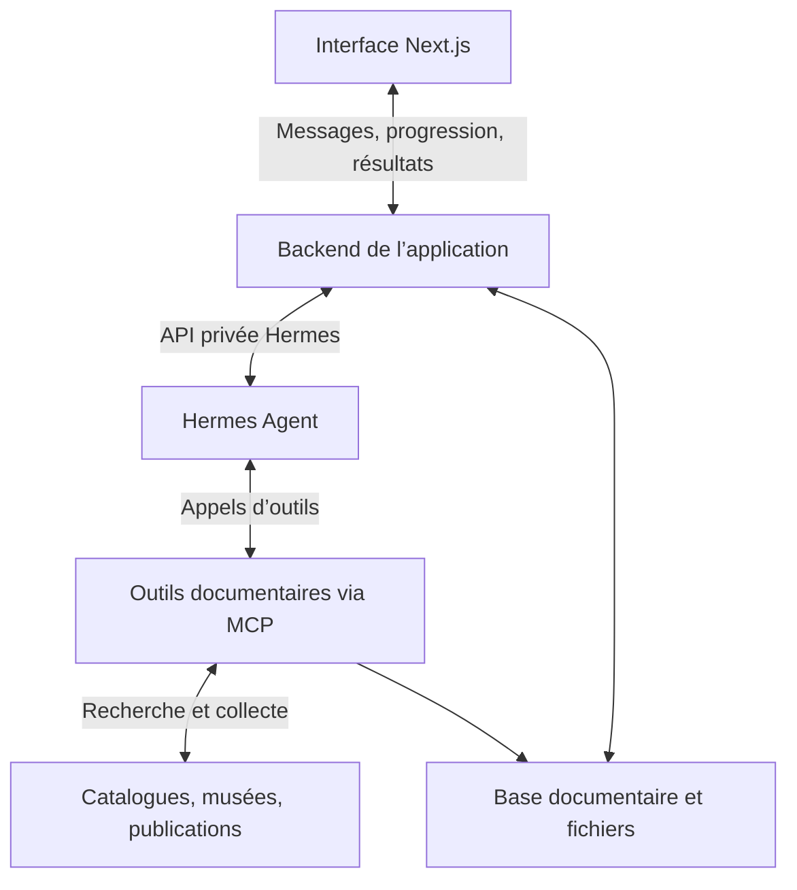
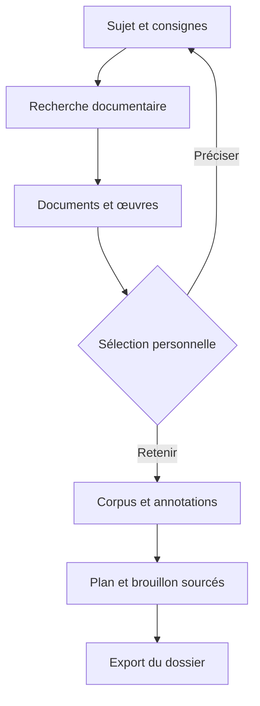

# Pupuce Intelligence

Atelier personnel de recherche documentaire pour l’histoire de l’art et l’archéologie. Explorer des références, conserver un corpus, annoter et préparer un oral avec un assistant connecté à Hermes.

## Architecture cible

## Parcours

## Direction visuelle

Structure compacte inspirée des références fournies ; langage visuel Renaissance et néoclassicisme : papier ivoire, encre, bordeaux, titres à empattements, grain et trame décorative. Texte et reproductions documentaires restent nets.

## État initial

Le README décrit l’architecture cible. Le code du premier MVP arrive sur une branche dédiée. Le périmètre effectivement disponible et ses limites sont documentés avec cette implémentation.
