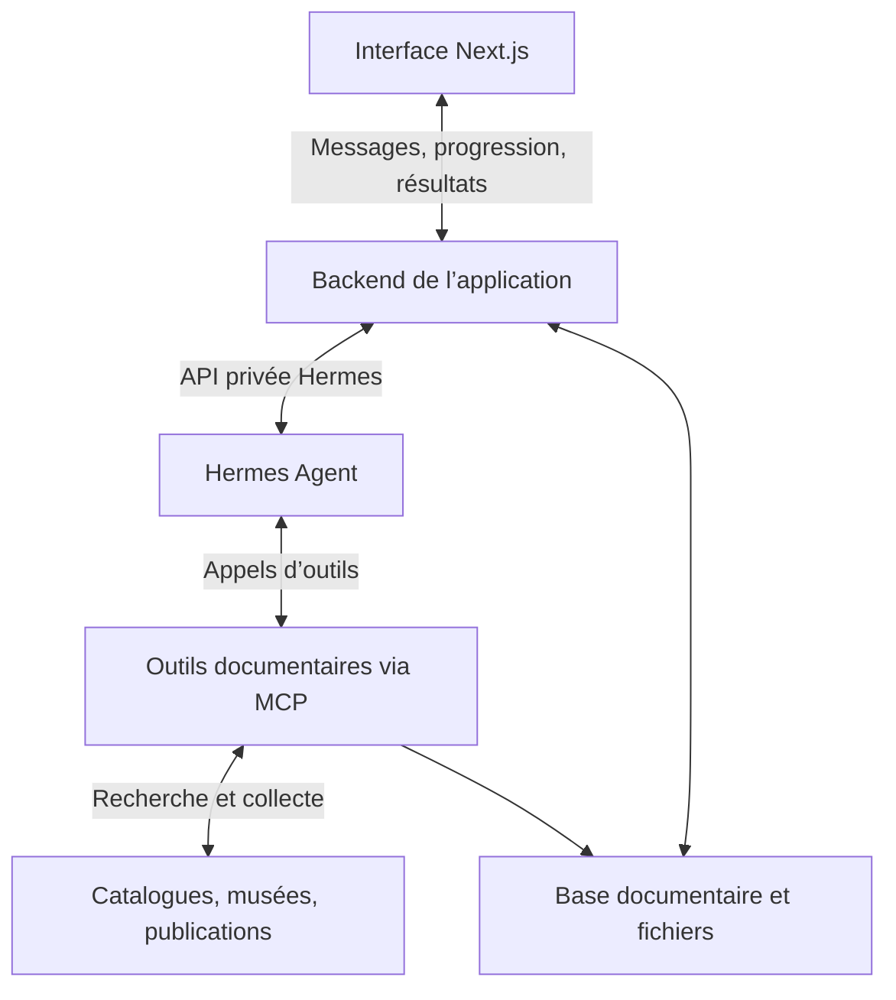
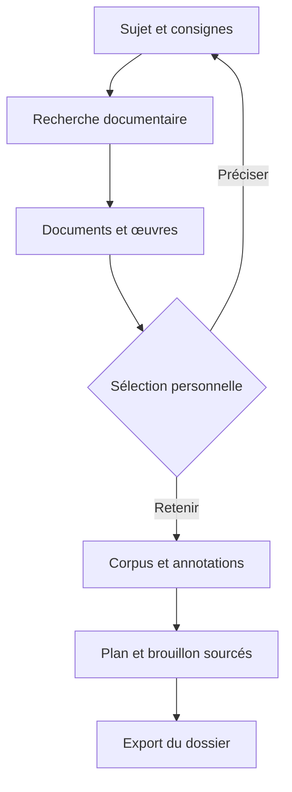

# Pupuce Intelligence

Atelier personnel de recherche documentaire pour l’histoire de l’art et l’archéologie. Explorer des références, conserver un corpus, annoter et préparer un oral avec un assistant connecté à Hermes.

## Architecture cible



## Parcours



## Direction visuelle

Structure compacte inspirée des références fournies ; langage visuel Renaissance et néoclassicisme : papier ivoire, encre, bordeaux, titres à empattements, grain et trame décorative. Texte et reproductions documentaires restent nets.

## Utilisation sur Mac

Pour installer Pupuce et Hermes localement avec un modèle via API : **[guide Mac prêt à suivre](INSTALLATION-MAC.md)**.

Lancer `Installer-Pupuce.command` une première fois. L’assistant configure le fournisseur API et crée quatre raccourcis sur le Bureau : ouvrir, arrêter, configurer l’IA et diagnostiquer. Le lancement quotidien démarre les deux services en local et ouvre le navigateur sans code à recopier. Aucun hébergement externe n’est nécessaire.

## Premier MVP disponible

- Interface Next.js responsive, thèmes papier et nocturne, grain et trame décorative, navigation au clavier et mouvement réduit.
- Dossiers indépendants, sélection de sources, notes et conversations sauvegardées dans le navigateur (IndexedDB, avec migration automatique de l’ancienne sauvegarde localStorage). Pas de synchronisation serveur à ce stade.
- Dossier de départ avec trois notices réellement récupérées dans l’API du Met et leurs reproductions CC0. Les portails BnF, Persée et Agorha sont des liens de départ, pas des articles prétendument consultés.
- Recherche réelle dans le Met (œuvres avec image Open Access) et Open Library (notices d’ouvrages, pas leur contenu). Les titres de ces catalogues peuvent être en anglais : essayer aussi des mots-clés anglais.
- Notice détaillée, provenance, identifiant d’inventaire, crédit et lien vers l’image HD lorsqu’ils sont disponibles.
- Import de cours par texte collé, export Markdown d’un dossier, sauvegarde JSON complète et restauration validée.
- Passerelle privée vers l’API Runs d’Hermes : démarrage, suivi par polling, reprise du suivi après rechargement, demande d’arrêt et erreurs explicites. Un redémarrage de l’application ne garantit pas la survie d’une exécution Hermes ; l’état remonté par Hermes fait foi.

## Démarrer

Node.js 22+ et npm.

```bash
npm ci
cp .env.example .env.local
npm run dev
```

Ouvrir http://localhost:3000. La bibliothèque et la recherche fonctionnent sans modèle IA. L’assistant affiche une erreur explicite tant qu’Hermes n’est pas connecté ; il ne simule pas de réponse.

```bash
npm test
npm run build
npm run typecheck
```

## Rédiger un dossier complet

L’onglet **Mon document** rassemble le plan, l’éditeur et les exports.

1. Sélectionner ses sources et ajouter ses notes de recherche.
2. Ouvrir **Structure et rédaction**, renommer/réordonner les parties et préciser les consignes (niveau, longueur, problématique).
3. Choisir **Créer la structure** pour écrire soi-même, ou **Rédiger le dossier complet** pour demander un brouillon à Hermes. Le suivi reprend quand l’onglet est rouvert ; une génération reste dépendante de la disponibilité d’Hermes et du fournisseur.
4. Relire le brouillon séparément, puis l’adopter. Le document existant n’est pas écrasé automatiquement ; sa version précédente peut être restaurée. Une réponse mal structurée ou une référence absente du corpus est refusée.
5. Modifier titres, paragraphes, listes, citations, gras, italique et liens. Le sommaire suit les titres. Ajouter une image JPEG/PNG avec sa légende ou utiliser une reproduction du corpus. Jusqu’à trois images accessibles du corpus sont incorporées automatiquement au brouillon ; les institutions peuvent interdire l’import direct et demander un téléchargement manuel.
6. Télécharger **Word** (vrai fichier DOCX éditable) ou **PDF** (A4, images incorporées, police de lecture intégrée, pagination). Les exports sont fabriqués à partir du contenu actuel, y compris les modifications manuelles. Le document Word utilise Georgia, sans exiger l’installation des polices de l’interface.

Le dossier Cabanel peut être converti en document éditable sans IA avec **Partir du dossier Cabanel**. L’onglet **Lire l’exemple** conserve la version éditoriale de référence.

Les documents et leurs images sont sauvegardés dans IndexedDB dans ce navigateur. Les anciennes sauvegardes localStorage sont reprises automatiquement sans supprimer l’original. L’export/restauration JSON inclut le document, le brouillon, la version précédente et les images. Les données restent propres à l’adresse locale ou à Vercel et au navigateur utilisé.

Limites : 4 Mo et 12 images par document ; les images importées sont optimisées automatiquement. PDF/OCR, collaboration et synchronisation serveur ne sont pas ajoutés. Les citations et analyses demandent une relecture humaine ; la vérification des identifiants ne prouve pas les affirmations. Le corpus envoyé reste borné à environ 23 500 caractères de notices/extraits et 15 000 caractères de notes pour la rédaction ; les omissions sont signalées au modèle.

Polices locales : EB Garamond et Source Sans 3, licences OFL incluses dans `public/fonts`. Aucune requête Google Fonts n’est nécessaire.

Pour les vérifications : `npm test`, `npm run build`, `npm run typecheck`, `npm run test:mac-launcher`. Tests navigateur : `npx playwright install chromium --only-shell`, puis `npm run test:e2e` après le build. La CI exécute le cycle de vie sur macOS/Linux et le parcours navigateur sur Linux. Les tests IA utilisent un Hermes simulé ; une vraie génération doit être validée avec le fournisseur configuré sur le Mac.

## Connecter Hermes

Installer et configurer une version d’Hermes supportant l’API Runs, avec son fournisseur de modèle et les outils de recherche souhaités. Référence : https://hermes-agent.nousresearch.com/docs/user-guide/features/api-server/

Dans `~/.hermes/.env` sur la machine Hermes :

```dotenv
API_SERVER_ENABLED=true
API_SERVER_KEY=<secret-hermes>
```

Puis lancer `hermes gateway`. Dans `.env.local` de Pupuce :

```dotenv
HERMES_URL=http://127.0.0.1:8642
HERMES_API_KEY=<meme-secret-hermes>
APP_ACCESS_KEY=<code-prive-de-l-atelier>
```

Le code APP_ACCESS_KEY se renseigne dans les réglages de l’interface. Il reste en mémoire dans l’onglet ; les secrets du fournisseur et d’Hermes ne quittent pas le serveur. En production, la passerelle refuse les requêtes si APP_ACCESS_KEY n’est pas configuré. Ce code partagé convient à un atelier personnel ; il ne remplace pas l’authentification et l’isolation nécessaires pour plusieurs utilisateurs.

Hermes doit tourner comme un service durable distinct du frontend. Son adresse est accessible depuis le backend, jamais exposée comme variable `NEXT_PUBLIC_`. Dans des conteneurs distincts, remplacer localhost par l’adresse interne du service.

L’application transmet le titre du dossier, jusqu’à 8 000 caractères de notes et les notices sélectionnées. Les cours sont limités à 6 000 caractères chacun et les sources à un budget global d’environ 34 000 caractères ; le contexte signale les sources omises. Aucun traitement exhaustif d’un long cours ni RAG n’est encore implémenté. Ne pas demander une synthèse exhaustive à partir de ces extraits.

## Limites et suite de l’architecture

La base documentaire serveur et le serveur MCP du schéma restent à implémenter. Pour l’instant, seuls les endpoints Next.js de recherche interrogent les deux catalogues, puis le navigateur conserve les résultats. Hermes reçoit le corpus sélectionné comme contexte ; il ne peut pas ajouter lui-même une carte à l’interface.

Les prochaines briques sont : stockage serveur avec authentification, outils MCP de collecte et d’enregistrement de notices, import PDF/OCR avec localisation des passages, recherche dans le corpus et vérification des affirmations/citations. Les consignes documentaires actuelles réduisent les inventions mais ne constituent pas une validation automatique des preuves.

Les reproductions sont documentées dans `public/art/ATTRIBUTION.md`. Le téléchargement HD ouvre la ressource officielle ; aucune image générée n’est présentée comme une œuvre historique.

La sauvegarde JSON contient les cours, notes, échanges, documents éditables et images incorporées : la conserver comme un document personnel. La restauration remplace l’atelier courant. Les clés API et le code d’accès ne sont pas inclus dans les exports. La suppression des données du navigateur efface la copie locale.

En hébergement partagé, ajouter avant ouverture : comptes utilisateurs, contrôle des dossiers côté serveur, limites d’usage et isolation des outils Hermes. Ne donner à Hermes que les outils et fichiers nécessaires au travail documentaire.

### Dossier exemple : L’Ange déchu

Le dossier Cabanel est un contenu éditorial préparé et sourcé, accessible sans Hermes : analyse visuelle signalée comme proposition, contexte, passages de Milton, comparaisons, réception, plan d’oral et bibliographie avec niveaux d’accès. Le catalogue de 2010 est une notice bibliographique, pas un livre ingéré. Les différences entre l’esquisse de Carpentras et le tableau du musée Fabre sont explicites. La reproduction de Rvalette est distribuée sans modification, sous CC BY-SA 3.0 (voir `public/art/ATTRIBUTION.md`).

Le guide de prise en main s’ouvre à la première visite du dossier et peut être relancé. Les suggestions préparent un message avant envoi ; elles ne simulent pas de réponse IA. Le dossier est ajouté aux sauvegardes existantes sans modifier leurs notes, sélections ou dossier actif. Les notes de l’exemple sont éditables et incluses dans l’export Markdown. L’onglet Dossier conserve la version éditoriale de référence. Le contexte envoyé à Hermes contient au plus 16 000 caractères de notes et indique leur éventuelle troncature.

### Modifications proposées par l’assistant

Dans la conversation, demander une modification des notes ou du document produit une proposition avec aperçu avant/après. **Valider les changements** est la seule action qui applique la proposition ; **Refuser** conserve le dossier. Les propositions sont conservées dans la sauvegarde locale. Si le contenu ciblé a été modifié entre-temps, une nouvelle proposition est nécessaire. La bibliothèque de sources n’est pas modifiable par ce mécanisme.

### Historique IA local

Le panneau « Historique et consommation IA » de l’assistant affiche les prompts, réponses, états et modèle, ainsi que les tokens entrée/sortie transmis par Hermes. Une absence de métriques est affichée explicitement ; aucun comptage estimé n’est présenté comme réel. Le suivi couvre aussi les demandes du studio documentaire. Les requêtes acceptées par Hermes sont enregistrées dans `~/Library/Application Support/Pupuce Intelligence/monitoring` (un JSON par exécution, incluant le contexte envoyé). `PUPUCE_MONITORING_DIR` permet de choisir un autre dossier. Les fichiers restent sur la machine qui héberge l’application ; l’API de lecture utilise le même contrôle d’accès que l’assistant.

### Importer des sources et documents

À la création d’un dossier ou avec **Ajouter des documents**, sélectionner ou glisser plusieurs PDF, fichiers Word `.docx`, images JPG/PNG/WebP ou fichiers TXT UTF-8. Les fichiers sont préparés puis rattachés au dossier au clic sur **Créer le dossier** ou **Ajouter au dossier**. Annuler ferme l’import sans ajouter les fichiers. Le texte collé reste disponible.

Les originaux sont inclus dans la sauvegarde de l’atelier (sur le Mac avec le lanceur local) et téléchargeables depuis la notice. Le texte des PDF est extrait avec les numéros de pages ; le Word conserve les paragraphes. L’extraction est locale au serveur Pupuce, sans appel IA. L’assistant reçoit uniquement les extraits sélectionnés et les limites d’extraction, jamais le fichier binaire. Les images, scans et PDF protégés sont conservés avec un message indiquant que leur contenu ne peut pas être lu automatiquement : il faut ajouter une description ou transcription. Les anciens `.doc` doivent être convertis en `.docx`.

Limites : 100 Mo par fichier, 12 fichiers par ajout, 300 Mo pour l’atelier sérialisé (originaux encodés compris), extraction de 100 pages et 200 000 caractères maximum par document. Les limites de contexte IA existantes restent applicables. Sur un hébergement externe, une limite d’envoi plus basse peut être imposée par l’hébergeur ; l’installation locale Mac accepte les limites ci-dessus.

### Import PowerPoint et documents volumineux

Les présentations `.pptx` sont importées comme sources : leur texte est extrait dans l’ordre des diapositives et transmis à l’assistant dans les mêmes limites de contexte que les autres documents. Les originaux restent téléchargeables et sont inclus dans la sauvegarde locale. Les anciens `.ppt` doivent être enregistrés en `.pptx` avec PowerPoint ou LibreOffice. Les images, graphiques, notes du présentateur et animations ne sont pas analysés. Une présentation sans texte affiche un avertissement.

Chaque fichier peut atteindre 100 Mio (104 857 600 octets). L’atelier sérialisé peut atteindre 300 millions de caractères, originaux encodés en base64 compris. La sauvegarde et la restauration acceptent cette nouvelle capacité. L’extraction PowerPoint est limitée à 100 diapositives et 200 000 caractères, avec signalement des extractions partielles. Les archives Office restent limitées à 400 Mo décompressés, et les XML PowerPoint à 20 Mo au total. L’import de gros fichiers et les sauvegardes peuvent demander davantage de mémoire et de temps.
